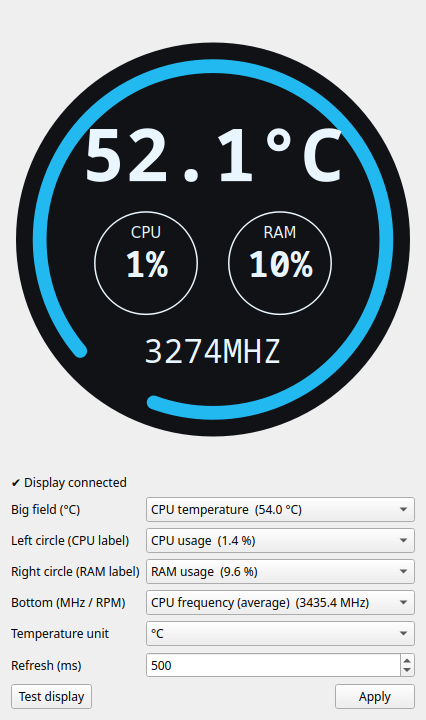

# darkflash-lcd-linux — darkFlash DN240D / DN360D AIO LCD on Linux

Linux app for the pump-head display of the **darkFlash Nebula DN240D / DN360D**
AIO liquid coolers (USB ID **`5131:2007`**). It shows CPU temperature, CPU and
RAM usage and CPU MHz (or any other sensor) on the cooler, has a Qt settings
window with a tray icon, and needs no root once installed.

**[English](#english) · [Español](#español)**

<p align="center"></p>

---

## English

### What it does

- Shows live values on the pump display, just like the official Windows app
  "darkFlash DN-D":
  - big field: CPU temperature, e.g. `42.5°C`
  - left circle (labelled CPU): CPU usage %
  - right circle (labelled RAM): RAM usage %
  - bottom: CPU frequency in MHz
- Any field can show another sensor instead: GPU temperature, NVMe
  temperature, fan RPM, the fastest core's MHz…
- Runs as a background service (systemd user service), so the display keeps
  working with the window closed.
- Qt settings window + tray icon (optional), plus a command-line tool.
- Display protocol ported **byte-for-byte** from the official Windows app and
  tested on real hardware.

### Can I show images or GIFs?

**No.** The DN240D/DN360D display is a fixed-segment LCD (like a calculator),
driven by a TM1721 chip. It only has fixed digits and symbols (`88.8°C`,
`188%`, `8888MHZ`). There are no pixels, so no software can draw an image on
it. Coolers with real image screens (IPS) are different products.

### "Linux doesn't detect my cooler"

It almost certainly does: `lsusb` shows it under a wrong name:

```
ID 5131:2007 MSR MSR-101U Mini HID magnetic card reader
```

That line **is** your cooler. darkFlash reused a generic USB ID, and Linux's ID
database names it after another product. Linux talks to it fine; what was
missing is a Linux app, and that's this project.

If there is no `5131:2007` line at all, the pump's USB cable is not connected
to an internal **USB 2.0 header** on the motherboard (or that header is
disabled in the BIOS).

### Installation

Requirements: any Linux distro with systemd, Python 3.10 or newer, and `git`.

**1. Install the prerequisites** (only what your distro is missing):

| Distro | Command |
|---|---|
| Fedora / Nobara | `sudo dnf install git python3` |
| Ubuntu / Debian / Mint / Pop!_OS | `sudo apt install git python3 python3-venv` |
| Arch / Manjaro / EndeavourOS / CachyOS | `sudo pacman -S git python` |
| openSUSE Tumbleweed | `sudo zypper install git python3` |
| openSUSE Leap | `sudo zypper install git python311` (Leap's default `python3` is too old) |

Ubuntu/Debian on X11 with the graphical app may also need `sudo apt install libxcb-cursor0`.

**2. Download and install:**

```bash
git clone https://github.com/Mumogg/darkflash-lcd-linux.git
cd darkflash-lcd-linux
./install.sh
```

The installer:

1. asks whether you also want the graphical app (`./install.sh --gui` or
   `--no-gui` to skip the question);
2. installs everything in your home folder (`~/.local`), without touching the
   system's Python;
3. installs a small **udev rule** so your user can talk to the cooler without
   root. This is the only step that asks for your `sudo` password;
4. enables and starts the background service;
5. runs `darkflash-lcd doctor` to check that everything works.

Within a second your cooler's display should show live values. Open
**"darkFlash LCD"** from your applications menu to change what it shows.

**Updating:** `cd darkflash-lcd-linux && git pull && ./install.sh`

**Uninstalling:** `./uninstall.sh` (your config in `~/.config/darkflash-lcd` is kept).

### Usage

Graphical app: **darkFlash LCD** in your menu, or `darkflash-lcd-gui`.
Pick a sensor for each field, press **Apply**. **Test display** lights every
segment. The tray icon shows the temperature and lets you pause the display
(on plain GNOME, the tray needs the *AppIndicator* extension; the window works without it).

Command line:

```bash
darkflash-lcd doctor                    # check USB, permissions, service, sensors
darkflash-lcd sensors                   # list every sensor id and its current value
darkflash-lcd status                    # what the service is sending right now
darkflash-lcd show 42.5 12 34 1234      # show fixed values for 10 s (--seconds N)
darkflash-lcd test                      # segment test (6 s)
darkflash-lcd pause | resume            # stop / resume updating the display
darkflash-lcd reload                    # re-read config.toml after editing it by hand
darkflash-lcd config set field2 gpu.temp   # right circle shows GPU temperature
darkflash-lcd config set unit F            # Fahrenheit
darkflash-lcd config set interval_ms 1000  # refresh every second
```

Service: `systemctl --user status|restart|stop darkflash-lcd`, logs with
`journalctl --user -u darkflash-lcd`.

### Display fields

| field | config key | position | accepts | range |
|---|---|---|---|---|
| 0 | `field0` | big `88.8°C` | temperatures | 0.0–99.9 (≥ 100 blinks `EE`, like Windows) |
| 1 | `field1` | left circle (CPU) | percent, temperatures | 0–199 |
| 2 | `field2` | right circle (RAM) | percent, temperatures | 0–199 |
| 3 | `field3` | bottom `8888MHZ` | MHz, fan RPM | 0–9999 |

With `unit = "F"` the numbers are Fahrenheit, but the display still prints the
fixed `°C` symbol (it's printed on the glass), and since the big field only goes
up to 99.9, anything from 100 °F (37.8 °C) up makes it blink `EE`. Fahrenheit is
mostly useful in the round fields.

Config file: `~/.config/darkflash-lcd/config.toml`.

### Troubleshooting

| `doctor` says | Fix |
|---|---|
| Cooler not found on USB | Plug the pump's USB cable into an internal USB 2.0 header; check BIOS USB settings. |
| No permission on /dev/hidrawN | Run `./install.sh` again (installs the udev rule), then unplug/replug or reboot. |
| Daemon not running | `systemctl --user enable --now darkflash-lcd` |

- **No fan RPM sensors listed:** load your motherboard's sensor driver, e.g.
  `sudo modprobe nct6775` (most ASUS/MSI/ASRock) or `it87` (Gigabyte), or run
  `sudo sensors-detect`. Then `systemctl --user restart darkflash-lcd` so the
  new sensors are picked up.
- **NVIDIA GPU temperature:** needs the proprietary driver (`nvidia-smi`).
- **Some segments look dimmer than others:** that's the display's backlight /
  LCD, not software (each segment is only on or off). It happens under Windows
  too.

### How it works

The official Windows app sends one 64-byte HID report to the cooler every
refresh. The protocol was reverse-engineered from that app and is documented in
[docs/PROTOCOL.md](docs/PROTOCOL.md). The Linux encoder is tested against 400
packets generated by running the original code (see
[tools/reverse/](tools/reverse/)). The app writes to `/dev/hidrawN` directly,
with no libusb and no kernel module.

Note: a few cheap magnetic card readers use the same USB ID `5131:2007`. This
app can't tell them apart from the cooler: if you have such a reader (and no
darkFlash cooler), don't install this, or stop the service with
`systemctl --user disable --now darkflash-lcd`.

### Contributing

Have a DN360D or another darkFlash display? Run `darkflash-lcd doctor` and open
an issue with the output. Development setup:

```bash
python3 -m venv .venv && .venv/bin/pip install -e '.[dev,gui]'
.venv/bin/pytest && .venv/bin/ruff check src tests
```

---

## Español

### Qué hace

- Muestra valores en vivo en la pantalla de la bomba, igual que la app oficial de
  Windows "darkFlash DN-D":
  - campo grande: temperatura de la CPU, por ejemplo `42.5°C`
  - círculo izquierdo (dice CPU): uso de CPU en %
  - círculo derecho (dice RAM): uso de RAM en %
  - abajo: frecuencia de la CPU en MHz
- Cualquier campo puede mostrar otro sensor: temperatura de la GPU o del NVMe,
  RPM de ventiladores, MHz del núcleo más rápido…
- Corre como servicio en segundo plano (servicio de usuario de systemd), así que
  la pantalla sigue funcionando con la ventana cerrada.
- Ventana de configuración en Qt + icono en la bandeja (opcional), y una
  herramienta de terminal.
- El protocolo de la pantalla está portado **byte por byte** desde la app oficial
  de Windows y probado en el hardware real.

### ¿Puedo poner imágenes o GIFs?

**No.** La pantalla del DN240D/DN360D es un LCD de segmentos fijos (como el de una
calculadora), controlado por un chip TM1721. Solo tiene dígitos y símbolos fijos
(`88.8°C`, `188%`, `8888MHZ`). No tiene píxeles, así que ningún programa puede
dibujar una imagen en ella. Las líquidas con pantalla de imágenes (IPS) son
otros productos.

### "Linux no detecta mi líquida"

Casi seguro sí la detecta: `lsusb` la muestra con otro nombre:

```
ID 5131:2007 MSR MSR-101U Mini HID magnetic card reader
```

Esa línea **es** tu líquida. darkFlash reutilizó un ID USB genérico y la base de
datos de Linux lo nombra como otro producto. Linux se comunica bien con ella; lo
que faltaba era una app para Linux, y eso es este proyecto.

Si no aparece ninguna línea `5131:2007`, el cable USB de la bomba no está
conectado a un **header USB 2.0** interno de la placa madre (o ese header está
desactivado en la BIOS).

### Instalación

Requisitos: cualquier distro Linux con systemd, Python 3.10 o superior y `git`.

**1. Instala lo necesario** (solo lo que le falte a tu distro):

| Distro | Comando |
|---|---|
| Fedora / Nobara | `sudo dnf install git python3` |
| Ubuntu / Debian / Mint / Pop!_OS | `sudo apt install git python3 python3-venv` |
| Arch / Manjaro / EndeavourOS / CachyOS | `sudo pacman -S git python` |
| openSUSE Tumbleweed | `sudo zypper install git python3` |
| openSUSE Leap | `sudo zypper install git python311` (el `python3` de Leap es muy viejo) |

En Ubuntu/Debian con X11, la app gráfica puede necesitar también `sudo apt install libxcb-cursor0`.

**2. Descarga e instala:**

```bash
git clone https://github.com/Mumogg/darkflash-lcd-linux.git
cd darkflash-lcd-linux
./install.sh
```

El instalador:

1. pregunta si también quieres la app gráfica (`./install.sh --gui` o
   `--no-gui` para no preguntar);
2. instala todo dentro de tu carpeta personal (`~/.local`), sin tocar el Python
   del sistema;
3. instala una pequeña **regla udev** para que tu usuario pueda hablar con la
   líquida sin ser root. Es el único paso que te pide la contraseña de `sudo`;
4. activa e inicia el servicio en segundo plano;
5. ejecuta `darkflash-lcd doctor` para comprobar que todo funciona.

En un segundo la pantalla de tu líquida debería mostrar valores en vivo. Abre
**"darkFlash LCD"** desde el menú de aplicaciones para cambiar lo que muestra.

**Actualizar:** `cd darkflash-lcd-linux && git pull && ./install.sh`

**Desinstalar:** `./uninstall.sh` (tu configuración en `~/.config/darkflash-lcd` se conserva).

### Uso

App gráfica: **darkFlash LCD** en el menú, o `darkflash-lcd-gui`.
Elige un sensor para cada campo y presiona **Apply**. **Test display** enciende
todos los segmentos. El icono de la bandeja muestra la temperatura y permite
pausar la pantalla (en GNOME puro, la bandeja necesita la extensión *AppIndicator*;
la ventana funciona sin ella).

Terminal:

```bash
darkflash-lcd doctor                    # revisa USB, permisos, servicio y sensores
darkflash-lcd sensors                   # lista los ids de sensores y su valor actual
darkflash-lcd status                    # qué está enviando el servicio ahora
darkflash-lcd show 42.5 12 34 1234      # muestra valores fijos 10 s (--seconds N)
darkflash-lcd test                      # prueba de segmentos (6 s)
darkflash-lcd pause | resume            # detener / reanudar la pantalla
darkflash-lcd reload                    # releer config.toml si lo editaste a mano
darkflash-lcd config set field2 gpu.temp   # el círculo derecho muestra la temp. de la GPU
darkflash-lcd config set unit F            # Fahrenheit
darkflash-lcd config set interval_ms 1000  # refrescar cada segundo
```

Servicio: `systemctl --user status|restart|stop darkflash-lcd`; registros con
`journalctl --user -u darkflash-lcd`.

### Campos de la pantalla

| campo | clave | posición | acepta | rango |
|---|---|---|---|---|
| 0 | `field0` | grande `88.8°C` | temperaturas | 0.0–99.9 (≥ 100 parpadea `EE`, como en Windows) |
| 1 | `field1` | círculo izquierdo (CPU) | porcentajes, temperaturas | 0–199 |
| 2 | `field2` | círculo derecho (RAM) | porcentajes, temperaturas | 0–199 |
| 3 | `field3` | abajo `8888MHZ` | MHz, RPM de ventiladores | 0–9999 |

Con `unit = "F"` los números van en Fahrenheit, pero la pantalla sigue mostrando
el símbolo `°C`, porque está impreso en el vidrio. Además, como el campo grande
llega solo a 99.9, desde 100 °F (37.8 °C) parpadea `EE`. Fahrenheit sirve más en
los círculos.

Archivo de configuración: `~/.config/darkflash-lcd/config.toml`.

### Problemas comunes

| `doctor` dice | Solución |
|---|---|
| Cooler not found on USB | Conecta el cable USB de la bomba a un header USB 2.0 interno; revisa el USB en la BIOS. |
| No permission on /dev/hidrawN | Vuelve a ejecutar `./install.sh` (instala la regla udev) y desconecta/conecta o reinicia. |
| Daemon not running | `systemctl --user enable --now darkflash-lcd` |

- **No aparecen RPM de ventiladores:** carga el driver de sensores de tu placa,
  por ejemplo `sudo modprobe nct6775` (la mayoría de ASUS/MSI/ASRock) o `it87`
  (Gigabyte), o ejecuta `sudo sensors-detect`. Después haz
  `systemctl --user restart darkflash-lcd` para que detecte los sensores nuevos.
- **Temperatura de GPU NVIDIA:** necesita el driver propietario (`nvidia-smi`).
- **Algunos segmentos se ven más tenues que otros:** es la iluminación o el LCD
  de la pantalla, no el software (cada segmento solo se enciende o se apaga).
  También pasa en Windows.

### Cómo funciona

La app oficial de Windows manda a la líquida un reporte HID de 64 bytes en cada
refresco. El protocolo se obtuvo con ingeniería inversa de esa app y está
documentado en [docs/PROTOCOL.md](docs/PROTOCOL.md). El codificador de Linux se
prueba contra 400 paquetes generados ejecutando el código original (ver
[tools/reverse/](tools/reverse/)). La app escribe directo a `/dev/hidrawN`, sin
libusb ni módulos del kernel.

Nota: algunos lectores de tarjetas magnéticas baratos usan el mismo ID USB
`5131:2007`. Esta app no puede distinguirlos de la líquida: si tienes uno de esos
lectores (y no una líquida darkFlash), no la instales, o detén el servicio con
`systemctl --user disable --now darkflash-lcd`.

---

## License / Licencia

[MIT](LICENSE). Not affiliated with or endorsed by darkFlash. / No está afiliado
ni respaldado por darkFlash.
